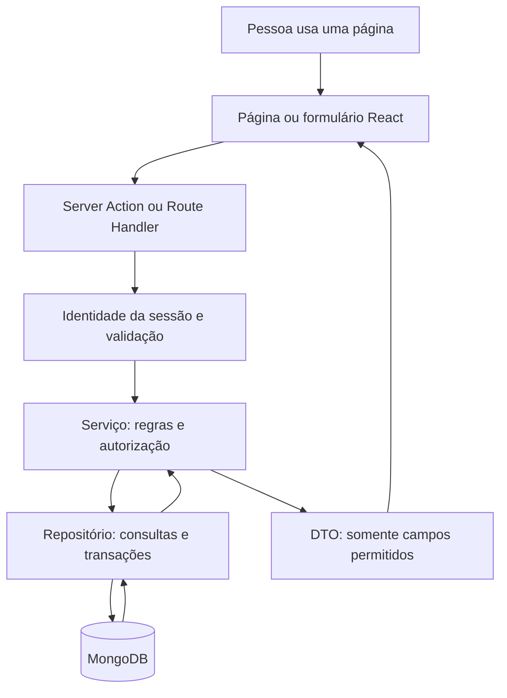

# Como o projeto Lista Natalina funciona

Este guia explica o código existente para estudo e manutenção. Leia primeiro a visão geral, depois acompanhe os fluxos de presentes e grupos com os arquivos abertos no editor. Os exemplos reduzidos estão identificados; os links apontam para as implementações completas. Não há credenciais nem dados reais nos exemplos.

## 1. O que está pronto e o que ainda falta

O projeto é uma aplicação **full-stack**: as páginas e o código que acessa o banco ficam no mesmo repositório Next.js. O navegador não acessa o MongoDB diretamente.

| Disponível nas Fases 1–5 | Ainda planejado |
| --- | --- |
| Cadastro, entrada, saída, sessão e perfil próprio | Geração do sorteio de amigo secreto |
| Adicionar, listar, editar e excluir seus presentes | Seção dedicada ao resultado individual |
| Grupos, participantes e transferência de administração | Invalidação e novo sorteio com cancelamento da edição |
| Listas compartilhadas por contexto e reservas privadas por grupo | Revisão final e deploy na Vercel |

O tipo amigo secreto já pode ser escolhido, mas **o sorteio ainda não é executado**. A estrutura, os bloqueios e a autorização de listas/reservas por destinatário estão preparados e testados com fixtures. Não confunda isso com a implementação da Fase 6.

A imagem de um presente é opcional. Nome, descrição e link do produto continuam obrigatórios. Não há confirmação de email nem recuperação de senha, conforme a definição do projeto.

## 2. As tecnologias e o papel de cada uma

| Tecnologia | O que faz aqui | Onde olhar |
| --- | --- | --- |
| Next.js com App Router | Define páginas por pastas, renderiza no servidor e recebe ações/formulários | `src/app` |
| React | Monta a interface a partir de componentes e controla interações locais | Arquivos `.tsx` |
| TypeScript | Descreve os contratos do código e detecta incompatibilidades antes da execução | `types.ts`, interfaces e tipos de argumentos |
| Tailwind CSS | Aplica espaçamento, cores, tamanhos e responsividade | `className` dos componentes e `globals.css` |
| Better Auth | Cuida do hash de senha, cookies e sessões persistidas | `src/modules/auth` |
| Driver oficial MongoDB | Executa consultas, índices e transações | `repository.ts` e `src/lib/db` |
| Zod | Valida dados que chegam em tempo de execução | `validation.ts` e `env.ts` |
| Vitest | Executa testes de regras, actions, configuração e integração | `*.test.ts` |
| Playwright | Usa um navegador de verdade para percorrer os fluxos | `e2e` |
| pnpm | Instala dependências e executa scripts usando o lockfile | `package.json`, `pnpm-lock.yaml` |

TypeScript não substitui Zod. Um argumento declarado como `string` no código ainda pode receber dados adulterados pela rede. Por isso, entrada externa é validada no servidor mesmo quando o formulário já usa `required` ou `type="url"`.

Não foram adicionados Redux, uma biblioteca de formulários ou um segundo backend. O estado das telas atuais cabe no React e os dados persistentes pertencem ao servidor.

## 3. Mapa das pastas

```text
lista-natalina/
├── src/
│   ├── app/                       # URLs, layouts e estados das páginas
│   │   ├── (auth)/                # Cadastro e entrada
│   │   ├── (private)/             # Área que exige sessão
│   │   │   ├── dashboard/         # Início após entrar
│   │   │   ├── perfil/            # Dados da própria conta
│   │   │   ├── presentes/         # Minha lista, novo e edição por ID
│   │   │   └── grupos/            # Meus grupos, novo e detalhes/edição
│   │   ├── api/auth/[...all]/     # Entrada HTTP da autenticação
│   │   ├── globals.css           # Tema e estilos base
│   │   ├── layout.tsx            # HTML, idioma e metadados globais
│   │   └── page.tsx              # Página pública /
│   ├── components/
│   │   ├── brand.tsx             # Nome e símbolo da aplicação
│   │   └── account-nav.tsx       # Menu da conta e seção atual
│   ├── lib/
│   │   ├── db/                   # Conexão MongoDB reutilizável
│   │   └── env/                  # Validação das variáveis privadas
│   └── modules/
│       ├── auth/                 # Identidade e sessões
│       ├── gifts/                # Lista pessoal de presentes
│       ├── groups/               # Grupos e participações
│       └── reservations/         # Listas contextuais, disponibilidade e reservas
├── public/images/                # Ilustração padrão do presente
├── e2e/                          # Fluxos de navegador desktop/celular
├── scripts/                      # Banco de testes, diagnóstico e ícones
├── docs/                         # Plano, regras e guias
├── .github/workflows/            # Verificação automática no GitHub
├── AGENTS.md                     # Regras para trabalhar neste repositório
├── CONTEXT.md                    # Estado resumido para continuidade
├── package.json                  # Dependências e scripts; deve ser mantido
└── pnpm-lock.yaml                # Versões resolvidas das dependências
```

O módulo `reservations` foi acrescentado na Fase 5; `secret-santa` será criado com os casos de uso da Fase 6. Não há arquivos vazios fingindo que essas funcionalidades estão prontas. A consulta mínima de usuários para adicionar membros está atualmente em `groups`, sem um módulo `users` artificial.

## 4. Como uma pasta vira uma página

| URL | Arquivo abaixo de `src/app` | Finalidade |
| --- | --- | --- |
| `/` | `page.tsx` | Explica como começar; entrada e cadastro |
| `/cadastro` | `(auth)/cadastro/page.tsx` | Criar conta |
| `/entrar` | `(auth)/entrar/page.tsx` | Entrar com email e senha |
| `/dashboard` | `(private)/dashboard/page.tsx` | Acessos à lista e aos grupos |
| `/perfil` | `(private)/perfil/page.tsx` | Nome e email da própria conta |
| `/presentes` | `(private)/presentes/page.tsx` | Lista pessoal paginada |
| `/presentes/novo` | `(private)/presentes/novo/page.tsx` | Formulário de criação |
| `/presentes/ID/editar` | `(private)/presentes/[id]/editar/page.tsx` | Edição de um presente próprio |
| `/grupos` | `(private)/grupos/page.tsx` | Grupos do usuário |
| `/grupos/novo` | `(private)/grupos/novo/page.tsx` | Criação de grupo |
| `/grupos/ID` | `(private)/grupos/[id]/page.tsx` | Informações, pessoas e administração |
| `/grupos/ID/editar` | `(private)/grupos/[id]/editar/page.tsx` | Edição pelo administrador |
| `/grupos/ID/listas/PESSOA` | `(private)/grupos/[id]/listas/[ownerId]/page.tsx` | Lista autorizada e reservas do grupo atual |
| `/api/auth/...` | `api/auth/[...all]/route.ts` | Operações HTTP de autenticação |

`(private)` e `(auth)` são **grupos de rotas**: organizam arquivos e compartilham layouts, mas os parênteses não entram na URL. `[id]` recebe um segmento variável. `[...all]` recebe os segmentos restantes do caminho da autenticação.

`layout.tsx` envolve as páginas da pasta. O layout privado valida a sessão e monta o cabeçalho/menu. Cada operação sensível também autentica e autoriza no servidor; não depende apenas dessa proteção visual.

`loading.tsx` mostra espera durante o carregamento; `error.tsx` oferece nova tentativa para falhas; `not-found.tsx` apresenta recursos inexistentes ou não autorizados sem revelar seus dados.

## 5. O caminho de uma informação



Para uma **leitura**, um Server Component pode chamar o serviço diretamente, sem criar uma API HTTP intermediária. Para uma **alteração**, o formulário de presentes/grupos chama uma Server Action. A autenticação usa Route Handlers porque precisa preservar o contrato HTTP, os cookies e o rate limiting do Better Auth.

### O papel de cada arquivo de um módulo

| Arquivo | Pergunta que responde | Exemplo |
| --- | --- | --- |
| `validation.ts` | A entrada tem formato válido? | O link usa HTTP/HTTPS? |
| `types.ts` | Quais contratos as partes trocam? | O que o repositório precisa oferecer? |
| `service.ts` | Esta pessoa pode fazer isso? Quais regras preservar? | Admin pode sair sem transferir? |
| `repository.ts` | Como consultar e gravar no MongoDB? | Filtro por dono, índice e transação |
| `server.ts` | Como montar as dependências reais? | Conectar, preparar índices, criar serviço |
| `actions.ts` | Como receber o formulário com segurança? | Ler sessão, extrair campos, chamar serviço |
| `components/` | Como a pessoa visualiza e usa a funcionalidade? | Card, formulário e diálogo |

O serviço recebe um repositório como argumento. Isso é **injeção de dependência**: a regra não cria sua própria conexão. Em produção recebe o repositório MongoDB; nos testes isolados recebe uma implementação falsa controlada pelo teste.

## 6. Autenticação: do cadastro à sessão

Arquivos centrais: [config.ts](../src/modules/auth/config.ts), [http.ts](../src/modules/auth/http.ts), [session.ts](../src/modules/auth/session.ts), [server.ts](../src/modules/auth/server.ts) e [validation.ts](../src/modules/auth/validation.ts).

1. `AuthForm` coleta nome/email/senha no cadastro ou email/senha na entrada.
2. Faz `POST /api/auth/sign-up/email` ou `POST /api/auth/sign-in/email`.
3. O adaptador HTTP verifica método, caminho permitido e origem da requisição. Lê um corpo limitado a 8192 bytes.
4. Zod valida e reconstrói apenas os campos permitidos. O email é normalizado; a senha não recebe `trim`, pois espaços podem fazer parte dela.
5. Better Auth usa hash **scrypt** para a senha e grava os dados de autenticação. Senha em texto puro não é persistida pelo aplicativo.
6. O servidor emite o cookie da sessão. O formulário redireciona para `/dashboard`.
7. As páginas privadas consultam a sessão no servidor e recebem somente o perfil necessário.

Trecho real de `config.ts`:

```ts
emailAndPassword: {
  enabled: true,
  minPasswordLength: 6,
  maxPasswordLength: 128,
  requireEmailVerification: false,
  autoSignIn: true,
},
session: {
  expiresIn: 7 * 24 * 60 * 60,
  updateAge: 24 * 60 * 60,
  cookieCache: { enabled: false },
},
```

`expiresIn` corresponde a sete dias; `updateAge` define o intervalo de atualização pela biblioteca. O índice TTL ajuda a remover sessões vencidas, mas não substitui a verificação de validade feita na leitura. O cookie é HttpOnly, SameSite=Lax e Secure quando a origem usa HTTPS. A aplicação não grava credenciais em `localStorage`.

Trecho real de `getCurrentUser`, reduzido à leitura bem-sucedida:

```ts
const auth = await getAuth();
const session = await auth.api.getSession({ headers: requestHeaders });
if (!session) return null;
const { id, name, email } = session.user;
return { id, name, email };
```

`requireCurrentUser()` usa essa função e redireciona para `/entrar` quando não existe sessão. Falha de banco gera erro genérico, sem fingir que a conta deixou de existir e sem imprimir a URI.

A saída chama `POST /api/auth/sign-out`. O cache de sessão em cookie está desabilitado: a próxima leitura precisa observar revogação/logout no banco.

A proteção contra excesso de tentativas fica persistida em `rateLimit`, funcionando entre instâncias. Fora da Vercel, a configuração não confia em headers arbitrários de IP; o contador pode ser compartilhado por usuários nessa configuração local. Na Vercel, usa o header definido pela plataforma.

## 7. Exemplo completo: adicionar um presente

Abra, nesta ordem:

1. [gift-form.tsx](../src/modules/gifts/components/gift-form.tsx).
2. [actions.ts](../src/modules/gifts/actions.ts).
3. [validation.ts](../src/modules/gifts/validation.ts).
4. [service.ts](../src/modules/gifts/service.ts).
5. [repository.ts](../src/modules/gifts/repository.ts).

### A interface reúne os campos

O formulário mantém os valores em `useState`, para não apagar o que a pessoa digitou quando o servidor rejeita um campo. `useActionState` recebe o resultado da action e informa se há envio pendente.

Trecho real, com a escolha da action:

```tsx
const action = gift ? updateGiftAction.bind(null, gift.id) : createGiftAction;
const [state, submit, pending] = useActionState<GiftActionState, FormData>(
  action,
  { message: "" },
);
```

Sem `gift`, é criação. Com `gift`, o mesmo formulário serve para editar. `bind` passa o ID como argumento; isso não transforma o ID em uma autorização. O servidor continua validando quem pode alterá-lo.

`pending` desabilita controles e muda o botão para “Salvando…”. `state.fields` associa mensagens aos campos; `state.message` mostra a falha geral. A imagem opcional fica em um `<details>`; uma imagem existente ou um erro nesse campo mantém a seção visível.

### A action recebe dados não confiáveis

Trecho real de `actions.ts`:

```ts
const user = await getCurrentUser();
if (!user) return { message: "Entre na sua conta para continuar." };

const input = giftInputSchema.safeParse({
  name: form.get("name"),
  description: form.get("description"),
  productUrl: form.get("productUrl"),
  imageUrl: form.get("imageUrl"),
});
```

Observe que não existe `ownerId: form.get("ownerId")`. O proprietário vem de `user.id`, obtido da sessão. Mesmo se alguém acrescentar campos ao POST, a action não aceita dono, datas ou estado de reserva enviados pelo cliente.

### A validação confere conteúdo e links

`giftInputSchema` exige nome, descrição e link do produto, limita tamanhos e aceita imagem vazia. Para uma URL informada, o código usa `new URL`, permite apenas `http:`/`https:`, rejeita credenciais embutidas e caracteres de controle/espaços na URL.

O backend **não baixa** o produto ou a imagem. A imagem externa é carregada pelo navegador; sem imagem ou com falha, [gift-image.tsx](../src/modules/gifts/components/gift-image.tsx) mostra `/images/gift-default.svg`. Abrir a loja usa outra aba com `noopener noreferrer`.

### O serviço aplica a regra

Trecho real de `service.ts`:

```ts
async create(actor: string | null, input: unknown) {
  const ownerId = actorId(actor);
  const data = validatedInput(input);
  const now = new Date();
  return toGiftView(await repository.insert({
    ...data, ownerId, createdAt: now, updatedAt: now,
  }));
},
```

`actor` é quem executa a operação, já identificado na borda. O serviço valida novamente o contrato para não depender de um único chamador. Datas são geradas no servidor.

`toGiftView`, em `gifts/dto.ts`, monta o DTO por campos permitidos e converte datas para texto ISO. **DTO** é o objeto de saída preparado para a interface; ele não é o documento completo do banco. O DTO do presente não tem disponibilidade nem identidade de reservante.

### O repositório persiste e a página atualiza

O repositório converte IDs para BSON ObjectId e executa `insertOne`. Depois do sucesso, a action chama `revalidatePath("/presentes")` e redireciona para `/presentes?status=criado`. A página traduz esse status para “Presente adicionado à sua lista.”.

O redirecionamento fica fora do `catch`: o Next usa uma exceção de controle para redirecionar. Capturá-la como erro comum poderia informar falha depois de uma gravação bem-sucedida.

## 8. Como o código impede editar o presente de outra pessoa

A proteção é aplicada também no filtro de escrita. Trecho real do repositório:

```ts
const owned = (ownerId: string, id: string) => ({
  _id: new ObjectId(id),
  ownerId: new ObjectId(ownerId),
});

const document = await gifts.findOneAndUpdate(
  owned(ownerId, id),
  { $set: input },
  { returnDocument: "after", projection },
);
```

O MongoDB só encontra um documento que corresponda **ao ID e ao dono**. Conhecer o ID de outro presente não permite atualizá-lo. Se nada for encontrado, o serviço devolve erro de recurso não encontrado, sem revelar detalhes do presente alheio. A mesma ideia aparece na leitura e na exclusão.

Uma consulta anterior do tipo “é meu?” seguida de update só por ID seria mais frágil. Aqui, a própria operação atômica contém a condição de autorização.

## 9. Como grupos e administração funcionam

Arquivos centrais: [service.ts](../src/modules/groups/service.ts), [types.ts](../src/modules/groups/types.ts), [repository.ts](../src/modules/groups/repository.ts) e [actions.ts](../src/modules/groups/actions.ts).

### Criação e participações

Um grupo é salvo em `groups`; cada participação é um documento em `memberships`. Criar grupo grava o grupo e a participação do criador na **mesma transação**. Se uma das operações falhar, nenhuma delas fica publicada isoladamente.

A administração tem uma única fonte: `groups.adminId`. Não existe um papel administrativo duplicado em uma sessão antiga. `memberCount` mantém a contagem para os cards, atualizada junto com as participações.

O índice único `(groupId, userId)` impede a mesma pessoa de entrar duas vezes no mesmo grupo, inclusive com requisições simultâneas.

### Regras do serviço

- Somente o administrador pode editar, adicionar/remover pessoas, transferir ou encerrar.
- Adicionar verifica que a conta existe e que ainda não participa.
- Membro comum pode sair quando não há sorteio ativo.
- Administrador não remove a si mesmo nem deixa outros membros sem administrador. Transfere antes; sendo o único, encerra com confirmação.
- Transferência só aceita um participante atual e existente.
- `activeDrawId` bloqueia alterações na composição e encerramento. Transferir administração e editar nome/descrição continuam permitidos.
- Tipo é definido na criação. Editar nome/descrição não converte o tipo do grupo.

### Por que existe uma escrita de coordenação

Imagine duas requisições ao mesmo tempo: Ana transfere a administração para Bruno enquanto uma outra aba de Ana tenta remover Bruno. Uma checagem fora da transação poderia usar uma visão antiga e remover o novo administrador.

O repositório primeiro disputa uma escrita no documento do grupo:

```ts
const document = await groups.findOneAndUpdate(
  { _id: oid(id) },
  { $inc: { writeVersion: 1 } },
  { session, returnDocument: "after", projection },
);
```

Dentro da mesma transação, o serviço relê a participação e confere `adminId`. Operações concorrentes no mesmo grupo entram em conflito de escrita. `withTransaction` pode repetir o callback; a repetição reavalia as permissões com o estado atualizado.

Trecho real da configuração transacional:

```ts
return await session.withTransaction(() => work(unit(session)), {
  readConcern: { level: "snapshot" },
  writeConcern: { w: "majority" },
});
```

`snapshot` fornece uma visão consistente para a transação; `majority` exige confirmação pela maioria dos membros do replica set. Por isso o ambiente precisa de Atlas/replica set, e os testes sobem um replica set descartável.

`writeVersion` muda em toda mutação; `membershipVersion` muda apenas com a composição. A transferência não muda a composição nem o sorteio ativo. As reservas já participam dessa coordenação. As futuras operações de sorteio precisam preservá-la para não usar autorizações invalidadas.

Não coloque envio de email ou outro efeito externo dentro desse callback: ele pode executar mais de uma vez por causa de uma repetição transacional.

### Pesquisa e leitura segura

A busca para adicionar usuários exige administrador, usa prefixo literal do nome, paginação e tempo máximo de consulta. Caracteres de regex são escapados. Busca vazia não abre um diretório de contas.

Repositório e serviço retornam apenas `{ id, name }` para outras pessoas. Email não é público. A leitura do grupo exige participação. Os testes verificam que um repositório falso retornando campos extras também não faz o serviço vazar email/senha.

## 10. MongoDB: documentos, referências e índices

| Coleção atual | Conteúdo | Garantia/consulta importante |
| --- | --- | --- |
| `user` | Perfil e email da conta | Email único; nome para busca |
| `account` | Credencial mantida pelo Better Auth, incluindo hash | Provider/account únicos; acesso por userId |
| `session` | Sessões persistidas | Token único, userId e TTL de expiração |
| `rateLimit` | Contadores de tentativas | Chave única; proteção entre instâncias |
| `gifts` | Presentes pessoais com ownerId | Índice ownerId + _id decrescente |
| `groups` | Nome, tipo, adminId, contagem, versões e ponteiro de edição | AdminId; documento de coordenação |
| `memberships` | groupId, userId e joinedAt | Par único e índice para listar grupos do usuário |
| `reservations` | Presente, grupo, dono, reservante, edição opcional e estado | Único parcial groupId/giftId quando ativo; cancelamento transacional |

A biblioteca também tem contrato para verificação; confirmação de email/recuperação não são oferecidas. `verification` não é um módulo de produto entregue. `reservations` já é funcional. Os índices de `draws` e `assignments` são preparados para a política de leitura; a geração/invalidação de edições ainda pertence à Fase 6.

Exemplo conceitual de relação, sem representar documentos reais:

```text
user:       Pessoa A
  ├─ gifts: Presente 1, Presente 2
  └─ memberships: Grupo Família, Grupo Amigos

groups:     Grupo Família
  ├─ adminId → Pessoa A
  └─ memberships → Pessoa A, Pessoa B, Pessoa C
```

Os grupos referenciam pessoas; não copiam suas listas. A pessoa mantém a mesma lista pessoal em todos os contextos futuros. Participações separadas evitam um array de tamanho ilimitado dentro do grupo.

MongoDB não impõe chaves estrangeiras como um banco relacional. A aplicação verifica referências, usa índices únicos e coordena mudanças relacionadas em transações. Alterações manuais externas não são reparadas automaticamente.

### Paginação por cursor

Presentes, grupos e participantes têm páginas de 24; pesquisa de candidatos, de 20. Isso limita a resposta de uma requisição, sem limitar o total de itens da pessoa.

Em presentes, o cursor é o último `_id` visível. A próxima página filtra `_id < cursor`, sempre com `ownerId`, ordena e busca 25 documentos. Os primeiros 24 são exibidos; o extra informa se existe continuação. Editar um presente não muda seu `_id` nem o faz saltar para o início por causa da data de atualização.

## 11. Conexão, variáveis e execução na Vercel

Veja [mongodb.ts](../src/lib/db/mongodb.ts) e [server.ts](../src/lib/env/server.ts).

A conexão é **lazy**: aberta quando uma operação precisa dela, não durante o import/build. Uma promessa em `globalThis.__listaNatalinaMongo` é compartilhada por chamadas na mesma instância. Isso evita dois pools ao mesmo tempo e facilita o desenvolvimento com recarga de módulos.

```ts
if (!globalThis.__listaNatalinaMongo) {
  // Cria o cliente e guarda a promessa de conexão.
  // Chamadas concorrentes aguardam essa mesma promessa.
}
return globalThis.__listaNatalinaMongo;
```

Esse trecho é um resumo didático; o arquivo real também configura pool/timeouts e fecha o cliente após uma falha inicial. Em caso de falha, a promessa é descartada para permitir nova tentativa. **Conexão compartilhada não é cache de dados de usuários.** Cada leitura continua com identidade e filtros próprios.

O pool tem máximo de dez conexões por instância. Na Vercel podem existir várias instâncias, cada uma com seu pool; não são dez conexões globais para toda a aplicação. Não há processo permanente nem dependência de arquivos locais persistentes.

| Variável | Uso |
| --- | --- |
| `DATABASE_URL` | URI MongoDB privada |
| `DATABASE_NAME` | Nome explícito do banco, quando não escolhido pela URI |
| `BETTER_AUTH_SECRET` | Segredo de assinatura da autenticação |
| `BETTER_AUTH_URL` | Origem autorizada, incluindo HTTPS na produção |

O banco local configurado é o banco real de produção. Cadastros manuais nele criam contas reais. Os testes de escrita usam outro MongoDB descartável. Não copie o `.env` para exemplos, commits, prints ou previews. O build não precisa se conectar ao banco. Deploy na Vercel ainda é uma etapa futura, com variáveis definidas por ambiente.

## 12. Interface: onde alterar cada parte

| Quero mudar... | Arquivo/pasta |
| --- | --- |
| Cores, fonte base e foco visível | `src/app/globals.css` |
| Nome/ícone do cabeçalho | `src/components/brand.tsx` |
| Menu e indicação da seção atual | `src/components/account-nav.tsx` |
| Cabeçalho privado e pular para conteúdo | `src/app/(private)/layout.tsx` |
| Página inicial e seus acessos | `src/app/page.tsx` e `(private)/dashboard/page.tsx` |
| Campos de cadastro/entrada e mostrar senha | `src/modules/auth/components/auth-form.tsx` |
| Card, campos, imagem e exclusão do presente | `src/modules/gifts/components` |
| Disponibilidade, reserva e cancelamento | `src/modules/reservations/components` e `actions.ts` |
| Formulário, card e confirmações de grupos | `src/modules/groups/components` |
| Organização das pessoas/pesquisa no grupo | `src/app/(private)/grupos/[id]/page.tsx` |

As páginas são **Server Components** por padrão: podem consultar serviços no servidor. Os componentes com `"use client"` usam estado, eventos ou APIs do navegador. Essa diretiva fica nos formulários, diálogos, imagem com fallback e menu ativo; não transforma o backend em código público. `server-only` protege os imports privados.

Na revisão de interface, os textos passaram a descrever a tarefa diretamente, a base ficou em 18 px, os controles principais têm pelo menos 48 px e a coluna dos formulários foi limitada. O menu visível tem `aria-current="page"`. O atalho “Pular para o conteúdo” evita percorrer o cabeçalho repetidamente com teclado.

Os `<dialog>` nativos mantêm foco no diálogo e tornam o fundo inerte. Cancelar preserva os dados e devolve o foco ao botão de origem. As confirmações de grupos dizem “Sim, remover”, “Sim, transferir”, “Sim, sair” ou “Sim, encerrar”. Confirmar na interface expressa intenção; não substitui validação no backend.

## 13. Testes: o que cada camada comprova

| Camada | Exemplos reais | O que não comprova sozinha |
| --- | --- | --- |
| Unidade | Entrada inválida, dono incorreto, admin sem permissão, DTO sem segredos | Índice ou transação de um MongoDB real |
| Actions | Sessão obrigatória, campos permitidos, confirmação, redirecionamento | Interação visual no navegador |
| Integração | Email único, índice de participação, rollback e operações concorrentes | Facilidade de uso da interface |
| E2E | Cadastro → lista → grupo, múltiplas sessões, teclado, cancelamento, desktop/celular | Auditoria completa de acessibilidade ou usabilidade com pessoas reais |

Exemplo completo de teste isolado. Este conteúdo pode ser colocado ao lado de `service.ts` em um arquivo de teste:

```ts
import { expect, it, vi } from "vitest";
import { createGiftService } from "./service";
import type { GiftRepository } from "./types";

it("não revela um presente que não pertence à pessoa", async () => {
  const repository = {
    insert: vi.fn(),
    findOwned: vi.fn().mockResolvedValue(null),
    listOwned: vi.fn(),
    updateOwned: vi.fn(),
    deleteOwned: vi.fn(),
  } satisfies GiftRepository;
  const service = createGiftService(repository);
  const actorId = "000000000000000000000001";
  const giftId = "000000000000000000000002";

  await expect(service.get(actorId, giftId)).rejects.toMatchObject({
    code: "not_found",
  });
  expect(repository.findOwned).toHaveBeenCalledWith(actorId, giftId);
});
```

`vi.fn()` cria uma função observável pelo teste. `mockResolvedValue(null)` simula uma consulta assíncrona que não encontrou documento autorizado. `satisfies GiftRepository` confere o contrato sem apagar os recursos de mock do objeto. `rejects` verifica a rejeição da promessa; `toHaveBeenCalledWith` confere que o dono foi incluído na consulta.

Veja os casos já existentes em [service.test.ts](../src/modules/gifts/service.test.ts) e [service.test.ts de grupos](../src/modules/groups/service.test.ts).

No TDD, escrevemos o comportamento esperado, observamos a falha, implementamos e executamos novamente. Para esta revisão, o novo E2E falhou antes da implementação porque não havia o botão de mostrar senha. O cenário também verifica menu atual, navegação por teclado, imagem opcional, cancelamento da exclusão e ausência de overflow no tamanho testado.

### Por que os testes não escrevem no banco real

[scripts/test-auth.sh](../scripts/test-auth.sh) sobe MongoDB `7.0.45` em Docker, com replica set, porta aleatória em loopback e dados em tmpfs. Os processos de teste recebem variáveis que substituem as locais. Helpers recusam uma URI fora do formato descartável esperado.

A fixture E2E limpa apenas `rateLimit` desse banco isolado entre cenários para que um cadastro de teste não consuma o limite do seguinte. Não desabilita a proteção da aplicação. Os testes próprios de auth continuam verificando os limites reais.

## 14. Comandos para trabalhar no projeto

```sh
pnpm install --frozen-lockfile  # Instala exatamente o lockfile
pnpm dev                      # Desenvolvimento em localhost:3000
pnpm test                     # Testes isolados
pnpm typecheck                # TypeScript, sem emitir arquivos JS
pnpm lint                     # Regras estáticas
pnpm build                    # Build de produção
pnpm check                    # Lint + tipos + unidade + build
pnpm test:integration         # MongoDB descartável e testes de persistência
pnpm test:e2e                 # Build + navegador + MongoDB descartável
```

Depois de um build, um fluxo específico pode ser executado com:

```sh
bash scripts/test-auth.sh e2e e2e/usability.spec.ts
```

`pnpm db:check` é um diagnóstico explícito de ping/topologia do banco configurado, somente leitura. Não é o runner de testes de escrita.

O workflow [.github/workflows/validacao.yml](../.github/workflows/validacao.yml) instala com lockfile e executa check, integração e navegador. Ele usa Node.js 24 e bancos descartáveis, sem precisar de credenciais de produção.

## 15. Como acrescentar uma regra sem misturar camadas

Exemplo implementado na Fase 5: reservar um presente. Este é o roteiro para acompanhar os arquivos de `src/modules/reservations` e aplicar a mesma separação a novas regras.

1. Escrever o teste: o dono não pode reservar o próprio presente; o mesmo presente admite uma reserva por grupo.
2. Validar IDs e contexto em um schema.
3. Obter a identidade da sessão na action.
4. No serviço, verificar grupo, participação, tipo e, no amigo secreto, edição ativa/destinatário.
5. No repositório, coordenar a transação com grupo/presente e gravar sob índice único parcial `(groupId, giftId)` para reservas ativas.
6. Retornar um DTO próprio para quem consulta: o dono não recebe nem o estado de reserva.
7. Testar concorrência contra MongoDB real, incluindo saída, exclusão e invalidação.
8. Acrescentar interface, testar o fluxo e revalidar somente após sucesso.

Compartilhar um grupo de amigo secreto não libera todas as listas. Mesmo que duas pessoas também pertençam a um grupo convencional, a permissão precisa considerar o **grupo acessado**. Reservas também pertencem ao grupo e, quando aplicável, à edição do sorteio. Essas regras estão detalhadas em [REGRAS-DE-NEGOCIO.md](REGRAS-DE-NEGOCIO.md).

## 16. Ordem sugerida de leitura do código

1. `src/app/(private)/presentes/page.tsx`: entenda como a página busca e exibe dados.
2. `gifts/components/gift-form.tsx` → `gifts/actions.ts`: acompanhe um envio.
3. `gifts/validation.ts` → `gifts/service.ts` → `gifts/repository.ts`: veja formato, regra e banco.
4. `auth/session.ts` → `auth/http.ts` → `auth/config.ts`: entenda identidade e sessão.
5. `groups/service.ts` → `groups/repository.ts`: estude transações e administração.
6. `reservations/service.ts` → `repository.ts` → `persistence.ts`: acompanhe a autorização contextual, o índice único e o cancelamento sistêmico.
7. Testes desses arquivos: compare cada regra com seus casos de sucesso, erro e concorrência.
8. `scripts/test-auth.sh` e `e2e`: acompanhe o caminho completo em um ambiente isolado.

Para decidir comportamento, consulte o [plano](PLANO.md) e as [regras definitivas](REGRAS-DE-NEGOCIO.md). Para saber o estado atual, consulte [CONTEXT.md](../CONTEXT.md) e o Git. Este guia explica a organização; os arquivos executáveis e seus testes continuam sendo a fonte do comportamento real.


## 17. Reservas: exemplo de concorrência e cancelamento

O fluxo real está em [service.ts](../src/modules/reservations/service.ts), [repository.ts](../src/modules/reservations/repository.ts) e [persistence.ts](../src/modules/reservations/persistence.ts). O contrato da rota e os testes estão em [FASE-5.md](FASE-5.md).

A reserva é por **grupo + presente**. Este trecho real cria a garantia final no MongoDB:

```ts
db.collection("reservations").createIndex(
  { groupId: 1, giftId: 1 },
  { unique: true, partialFilterExpression: { status: "active" } },
);
```

O índice ignora reservas canceladas. Duas requisições para o mesmo par não conseguem publicar duas reservas ativas; a que perde recebe um conflito público de indisponibilidade. Outro groupId cria outro contexto e pode ter outro reservante para o mesmo presente.

Antes de inserir, o serviço autentica na borda, valida IDs, escreve o grupo para disputar concorrência, confere os dois participantes e a política do tipo, disputa o presente e confirma seu dono. A edição de amigo secreto vem do grupo ativo; o autor vem da sessão. Não aceita esses dados como autoridade do formulário.

A escrita do presente incrementa reservationVersion, sem alterar sua data pública. Ela coordena com a exclusão transacional: cancelar todas as reservas e remover o presente precisam ocorrer no mesmo commit. Caso contrário, seria possível ler um presente existente, excluí-lo em outra requisição e depois inserir uma reserva órfã.

Na saída/remoção, o repositório cancela reservas com groupId atual e reservedBy ou ownerId da pessoa removida. Os outros grupos continuam intactos. ownerId foi armazenado a partir do presente, permitindo essa consulta sem carregar uma lista inteira. O cancelamento fica na mesma sessão da remoção da participação; se algo falhar, ambos voltam ao estado anterior.

O dono usa sempre `toGiftView`, sem campos de reserva. Terceiros autorizados recebem só availability e canCancel. O repositório lê apenas a página corrente e não retorna a identidade de outra pessoa à interface. O botão “Atualizar lista” busca um novo snapshot após conflito, sem reenviar uma reserva.
